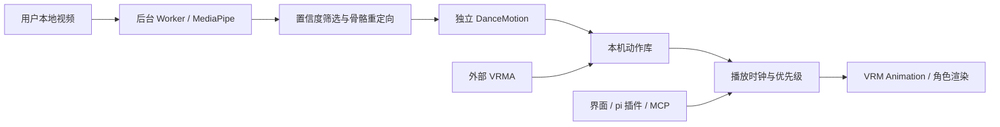

# 让 Debby 从视频学舞蹈

2026-10-25 调研与实现。当前接入的是动作提取、重定向和保存，学习结果是可重复播放的骨骼动作，不是训练 LLM，也不会从视频中自动生成角色模型。VRM 是角色，VRMA 是动作。

## 直接体验

运行 `npm.cmd run dev`，在桌宠「更多 → 学跳舞」中打开工作室。可以先播放「Debby 的小小律动」，它是内置原创的 8 秒动作，明确标记为内置，并非视频识别结果。

选择本地 MP4 / WebM 视频，填写动作名，截取 0.5–60 秒，必要时勾选镜像，再点「开始学习」。推荐单人、全身清晰、固定机位；最大视频 256 MB、分辨率不超过 4K。处理时显示骨架与进度，可以取消，关闭窗口、隐藏桌宠、锁屏或休眠也会中止学习。只有完成并通过输入校验的动作才加入库。

识别按 24 FPS 采样，输入最长边缩至 720 像素，运行在后台 Worker。模型和 WASM 在首次启动/构建前自动准备（模型约 9 MB），之后识别不需要联网，不使用摄像头，也不上传原视频。CPU 路线可以在本机 AMD Radeon RX 9070 XT 上运行，不依赖 CUDA。

动作库显示来源、时长和全身可见帧比例；这个比例不是动作精度分数。播放自动展开全身、收起面板，气泡里可暂停、继续、拖动进度或停止。停止后恢复原视图。速度支持 0.5–1.5 倍，可循环。重启保留动作，不保留播放状态；原始视频和音频不写入动作库，当前播放不带原视频配乐。

可导入单段、自包含的二进制 `.vrma`，或导入/导出 `.debbydance.json`。VRMA 导出保留原文件，视频动作目前导出为 Debby JSON，并非 VRMA。动作文件上限 16 MB / 180 秒。库最多保存 64 个用户动作。移除会将对应 JSON 改名为 `.json.removed` 留在用户数据的 `dances` 目录，手动去掉 `.removed` 并重启即可恢复。

内置文字/语音 Agent 已注册 `list_dances`、`control_dance` 工具；用户说“跳支舞”时，模型可以选择已保存的动作。模型需要现有 BYOK，对动作识别本身没有 Key 要求。学习新的本地视频仍由用户在工作室操作，Agent 不能读取任意视频路径。

## 调研选择

| 项目 | 能力与成本 | Debby 的选择 |
| --- | --- | --- |
| [MediaPipe Pose Landmarker](https://developers.google.com/edge/mediapipe/solutions/vision/pose_landmarker/web_js) | 33 个图像/世界坐标关键点；本机浏览器推理。软件和模型卡列 Apache-2.0 | 默认实现；固定 Tasks Vision 0.10.32、Full 模型 v1，SHA-256 校验资源 |
| [Kalidokit](https://github.com/yeemachine/kalidokit) | MIT；已有 MediaPipe 到 VRM 的解算示例 | 参考解算流程，不复制旧版 VRM 轴向实现；使用独立的现代规范化骨骼适配器 |
| [three-vrm-animation](https://github.com/pixiv/three-vrm/tree/dev/packages/three-vrm-animation) | MIT；VRMA 解析、规范化动作转目标 VRM Clip | 实际接入 3.5.5，统一处理 VRM 0.x / 1.0 坐标差异 |
| [GVHMR](https://github.com/zju3dv/GVHMR) | 更完整的单目人体及地面运动重建；[安装说明](https://github.com/zju3dv/GVHMR/blob/main/docs/INSTALL.md) 依赖 CUDA/PyTorch 和额外模型；[非商用条款](https://github.com/zju3dv/GVHMR/blob/main/LICENSE) | 保留外部后端扩展口；未安装，不作为 AMD 用户默认依赖。后续可经 Blender 等转换成 VRMA 导入 |
| [video2bvh](https://github.com/KevinLTT/video2bvh) | MIT；旧式 2D → VideoPose3D → BVH/Blender 工具链 | 不额外引入旧 Python 环境；外部制作完成的动作走标准格式 |
| [vrm-motion-capture](https://github.com/camenduru/vrm-motion-capture) | Python RTMPose/ONNX、WebSocket 与浏览器 VRM 组合 | 参考分层，未复制其代码；调研时未找到明确仓库许可 |

这轮没有安装庞大的 Unity/Python 动捕环境，也未打包第三方舞蹈素材。MediaPipe 模型卡与完整上游许可证见 [资源来源](../src/renderer/public/mocap/SOURCE.md)。默认 Zome 模型原有分发约束仍适用。

## 数据流与替换位置



- `src/shared/dance.ts`：不依赖 React/Three.js/MediaPipe 的动作、库、播放协议与输入校验。局部四元数为 canonical VRM 1.0 normalized humanoid 坐标，`xyzw` 顺序。
- `src/renderer/src/motion/video-capture.ts`：`VideoMotionBackend.capture(video, options)` 返回 `Promise<DanceMotion>`；进度回调、AbortSignal、截取与镜像都在边界上。`DanceStudio` 的 `capture` 属性接受替换实现。
- `src/renderer/src/motion/pose-retarget.ts`：输入仅为关键点序列，输出动作；短缺失插值、角速度约束、前后向四元数平滑，与识别 SDK 独立。
- `src/main/dance-library.ts`：原子保存、损坏记录隔离、容量/格式/路径校验、改名保留移除动作、播放时钟。Agent 无权导入、删除或读取原视频。
- `use-dance-player.ts`：订阅 Hook；忽略迟到状态和过时素材加载结果。`DanceAnimator` 专注 VRM/VRMA 映射、播放位置和进出姿态混合。
- `createDanceToolsPlugin(port)`：内置 pi 工具工厂，只依赖状态/控制端口；不要求更换模型、语音或市场数据实现。

单目视频无法恢复所有遮挡、手指与精确地面接触。当前有原地动作、脚部高度校正和平滑，没有承诺专业足底锁定 IK、无脚滑或复杂地板动作重建。转身、交叉肢体、宽松服装和快速运动需要预览检查；可见全身的帧不足 55% 会拒绝保存。后续高质量后端可实现 `VideoMotionBackend`，也可直接产出 VRMA。

## Agent 接入

现有 MCP 配置保持兼容，新增 `debby_list_dances` 和 `debby_dance`。先读库、创建任务，再发播放指令。任务取消、断开或租约到期会停止该外部 Agent 的舞蹈；用户操作优先，不会被外部 Agent 抢占。内置 pi 与外部 Agent 也分别记录所有者。

```js
import { DebbyClient } from '../integrations/client.mjs'
import { setTimeout } from 'node:timers/promises'
const debby = new DebbyClient(connectionFilePath, 'My Harness')
try {
  const { library } = await debby.listDances()
  await debby.setTask('dance-unique-1', '和你跳支舞', 'working')
  await debby.dance('dance-unique-1', { action: 'play', id: library[0].id, loop: false })
  // Keep your session open while playing. Poll getState for cancellation.
  // await debby.dance('dance-unique-1', { action: 'pause' })
  // await debby.dance('dance-unique-1', { action: 'resume' })
  // await debby.dance('dance-unique-1', { action: 'stop' })
  while ((await debby.listDances()).playback?.origin === 'agent') {
    if ((await debby.getState()).task?.status === 'cancelled') break
    await setTimeout(250)
  }
} finally {
  await debby.release() // Also stops this Agent's dance.
}
```

可直接运行 `node examples/dance-agent.mjs "连接文件完整路径"`。`release` 会停止动作，所以示例等待动作结束或用户取消再释放。完整会话用法见 [MCP 接入](mcp-integration.md)。

## 验证

```powershell
npm.cmd run typecheck
npm.cmd test
npm.cmd run test:dance-ui
npm.cmd run test:agent-shell
```

舞蹈桌面测试使用真实本地 WASM 推理，不模拟识别器。默认下载并校验 [MediaPipe 官方人体示例视频](https://mediapipe.dev/images/mobile/pose_world_landmarks.mp4)，仅放在忽略的 `work`。也可通过 `DEBBY_DANCE_TEST_VIDEO` 指定自己的文件、`DEBBY_DANCE_TEST_SECONDS` 指定片段长度。该测试覆盖识别、骨骼变化、暂停保持姿态、进度跳转、取消、标准 VRMA、导入导出与重启持久化。

另外以 [AIST++ 官方示例](https://google.github.io/aistplusplus_dataset/factsfigures.html) 的真人舞蹈单机位裁剪片段进行本机验证，样本不随仓库分发。样本帧可见比例仅描述这次输入，不代表任意网络视频都能获得同样效果。
