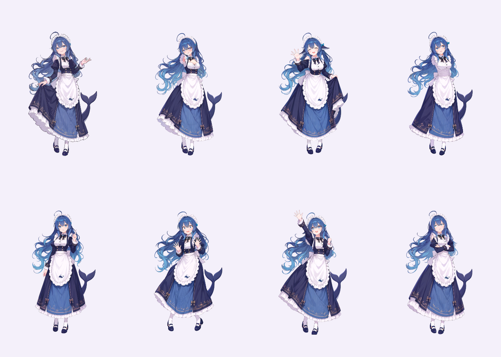

# 同一位鲸鱼娘，多张分层表情立绘

Debby 的 `.debby` 角色包为同一位角色保存多张独立分层 PSD，以及「对话情绪 / 身体动作 → 立绘」映射。默认角色仍是 DeepSeek 社区二创鲸鱼娘；换表情时可以连同原画的手势一起切换，目光、口型与基础动作继续播放。

内置八张：日常陪伴、害羞贴贴、开心招手、好奇思考、认真分析、惊讶、为你喝彩和小小无奈。每张包含 18–27 个语义部件，均经过实际本机推理和逐张渲染验收；开心闭眼图使用自己的闭眼线条，其余七张分别检查左右虹膜响应。来源和结果哈希见角色目录的 `expressions-provenance.json`。

[22.4 秒真实运行时预览](../media/demo/debby-whale-expressions.mp4)：使用浏览器宿主示例播放，画面中的口型为本地预览输入，静音，不包含云模型对话。



## 使用

打开角色工坊，选择「遇见鲸鱼娘」。「试试表情」预览对话情绪，「表情立绘」可以逐张检查原画。「动作与幅度」默认 1.9×，可在 0.6×–2.4× 之间调整，保存角色后记住设置。默认仍显示上半身。减少动态效果的系统设置优先，口型继续响应语音。

动作幅度控制摆头、身体摆动、抬手和挥手；不会把眼球位移或音频幅度一同放大。独立手臂网格在肩部附近保持连接，远端转动，已经高举的手向外挥动，避免继续向上抬出画布。拎裙装等有接触关系的手，可用 `freeArm` 固定，挥动另一只手；`left` / `right` 指画面中的左右。图片的网格形变不等同于完整人体 IK；VRMA 舞蹈继续走原有 3D 骨骼后端。

每张插画独立经过 See-through 拆层、补绘、深度排序与 PSD 验收。原本闭眼的立绘使用它自己的闭眼线条，不补画不存在的睁眼虹膜。原本张嘴的开心或惊讶表情可设置 `mouthRest`，说话幅度仍由真实语音决定。

## 制作自己的同角色表情组

先用 [拆层流程](image-to-parts.md) 将每张图片各自生成 PSD，检查脸、衣服、手臂和遮挡关系。将以下配置保存为 `poses.json`，路径相对于此配置文件：

```json
{
  "name": "Debby · 我的角色",
  "defaultPose": "calm",
  "poses": [
    { "id": "calm", "label": "陪伴", "file": "calm.psd", "freeArm": "right" },
    { "id": "happy", "label": "开心招手", "file": "happy.psd", "eyes": "closed", "mouthRest": 0.65, "freeArm": "left" }
  ],
  "expressions": { "neutral": "calm", "caring": "calm", "happy": "happy", "proud": "happy" },
  "behaviors": { "greet": "happy", "celebrate": "happy" }
}
```

```powershell
npm.cmd run avatar:pack-expressions -- D:/art/poses.json D:/art/character.debby
```

在角色工坊导入 `character.debby` 即可。支持 2–12 张 RGB / 8 bit PSD；每张不超过 16 MB，解码 PSD 共不超过 48 MB，完整角色包不超过 64 MB。文件内嵌 PSD 与各自 SHA-256，不引用外部网址或本机路径。打包器输出新文件，避免覆盖现有角色。

## Agent 与宿主接入

继续使用 `[[emotion:shy|0.8]]` 或 MCP / Agent 的 typed `expression`，无需增加一套协议。映射优先级：工坊显式预览立绘 → 有效对话表情 → 当前身体动作 → 默认立绘；未指定的表情回到默认。没有对话表情和动作立绘时，行情的开心 / 安慰参数仍可选择对应立绘。图像中的手势是原画的一部分，切换立绘不会额外执行身体动作命令。

- `src/shared/expression-avatar.ts`：可移植文档、限额校验、情绪/动作选择。
- `scripts/pack-expression-avatar.mjs`：可注入取消信号的独立打包函数，旁边提供类型声明。
- `PortableAvatarBackend.parse`：自动识别 PSD、StandRig 和 `.debby`，逐张校验并在 Worker 中绑定。
- `createLayeredSurface`：自动选择多立绘运行时，仍然使用同一 `frame` 表情/动作输入。
- `LayeredAvatarSurface.viewRig()`：返回当前立绘的画布和脸部锚点，供上半身裁切使用。
- `LayeredAvatarDriver.frame` 的 `context.pose`：宿主可显式预览某张立绘，平时省略。

运行时仅使用一个 WebGL 上下文，共用一套着色器与眼部遮罩，最多缓存两组立绘贴图，淘汰时释放旧资源。切换保留动画时钟、鼠标坐标、口型输入和控制者归属；新贴图准备好前保留当前画面，不叠加两张人物。解析、播放、图片制作、LLM 和摄像头互相独立。

## 验证

`npm.cmd run test:expression-avatar` 使用隐藏、不可聚焦、静音的独立 Electron 目录，验证真实角色包的逐张渲染、表情协议 / MCP 切换、有限贴图缓存、连续口型与时钟、幅度保存/恢复，以及舞蹈后恢复立绘。截图保存在忽略的 `work/expression-avatar/`，不请求摄像头、麦克风或云模型。

单张生成结果可用 `tests/decomposed-avatar.e2e.mjs` 的 `DEBBY_DECOMPOSED_PSD`、`DEBBY_DECOMPOSED_SOURCE`、`DEBBY_DECOMPOSED_EVIDENCE` 指定测试输入与证据目录；闭眼图设置 `DEBBY_DECOMPOSED_CLOSED_EYES=1`。验收包含左右虹膜各自的可见像素响应、原图轮廓覆盖和较大动作下的身体像素变化；拆层深度排序把虹膜放在眼白后面时应先修整再复核。闭眼图不要求不存在的虹膜移动。批量复核资产时可用 `DEBBY_DECOMPOSED_PIXELS_ONLY=1` 仅执行像素验收，完整桌面流程由默认模式及多立绘 E2E 覆盖。

鲸鱼娘素材仍为 CC BY-NC-SA 4.0，保留原署名链。模型制作不改变原画许可，DeepSeek 官方未为本项目背书。
